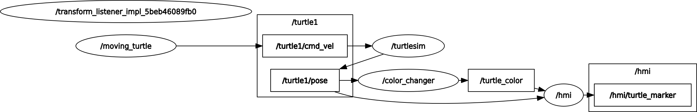

# 2026 Automotive Software — Simple ROS Project (Team 00)

A simple ROS2 Humble project built on Turtlesim. It does three things:

- Moves the turtle by repeating a straight move and an in-place rotation.
- Changes the background color based on the turtle's heading.
- Visualizes the turtle's position and color as an RViz Marker.

[스크린캐스트 10-16-2026 05:45:53 PM.webm](https://github.com/user-attachments/assets/2e30e4b4-e17f-443b-b17a-a45b7af526e6)


## Team

| Name | Role | Responsibility |
|---|---|---|
| Heemin Oh | Leader | `moving_turtle` node, `hmi` node |
| Dongmyeong Jeong | Member | `color_changer` node, Launch Files |

## System Architecture


## Nodes

### `moving_turtle` (Heemin Oh)
- Publishes `geometry_msgs/msg/Twist` to `/turtle1/cmd_vel` at 100 Hz.
- For 100 loops, it moves straight with `linear.x = 2.0` and `angular.z = 0.0`.
- For the next 100 loops, it rotates in place with `linear.x = 0.0` and `angular.z = 1.0`.
- It repeats these two motions continuously.

### `color_changer` (Dongmyeong Jeong)
- Subscribes to `/turtle1/pose` and runs at 10 Hz.
- Converts `theta` from radians to degrees, then normalizes it to `[-180°, 180°)`, because `Pose.theta` is float32.
- Sets the turtlesim `background_r/g/b` parameters through an `AsyncParametersClient`. These parameters take integers from 0 to 255.
- Publishes the same color to the HMI node as a `TurtleColor` message, with floats from 0.0 to 1.0.

| Theta range | Background (R, G, B) | TurtleColor |
|---|---|---|
| 0° ≤ θ < 90° | (255, 255, 255) | (1.0, 1.0, 1.0) |
| 90° ≤ θ < 180° | (255, 0, 0) | (1.0, 0.0, 0.0) |
| -180° ≤ θ < -90° | (0, 255, 0) | (0.0, 1.0, 0.0) |
| -90° ≤ θ < 0° | (0, 0, 255) | (0.0, 0.0, 1.0) |

### `hmi` (Heemin Oh)
- Subscribes to `/turtle1/pose` and `TurtleColor`.
- Builds a `visualization_msgs/msg/Marker` from both and publishes it at 60 Hz. The Marker fields are:
  - `header.frame_id` is `"map"`, and `header.stamp` is the current ROS time.
  - `type` is `CUBE`, and `action` is `ADD`.
  - `pose.position` is the turtle's (x, y, 0.0), and `orientation` is (0, 0, 0, 1).
  - `scale` is (1.0, 1.0, 1.0).
  - `color.r/g/b` comes from `TurtleColor`, and `color.a` is 1.0.

## Custom Message

`TurtleColor.msg`
```
float32 red
float32 green
float32 blue
```

## Build & Run

```bash
# From the workspace root
colcon build
source install/setup.bash

# Launch turtlesim, all three nodes, and rviz2 at once (XML launch)
ros2 launch <launch_package> <launch_file>.launch.xml
```

Check node connections with `rqt_graph`, and message contents with `ros2 topic echo`.

```bash
rqt_graph
ros2 topic echo /turtle1/cmd_vel
ros2 topic echo <marker_topic>
```
## Node Graph (rqt_graph)



## Directory Structure

```
.
├── launch/
│   ├── simple_project.xml    # Launches all nodes at once (Dongmyeong Jeong)
│   └── simple_project.rviz   # RViz config: map frame + turtle marker
├── docs/
│   └── rqt_graph.png         # Node graph of the launched system
└── src/
    ├── my_msgs/              # TurtleColor.msg
    ├── moving_turtle/        # Heemin Oh
    ├── color_changer/        # Dongmyeong Jeong
    └── hmi/                  # Heemin Oh
```

> `build/`, `install/`, and `log/` are excluded via `.gitignore`.
